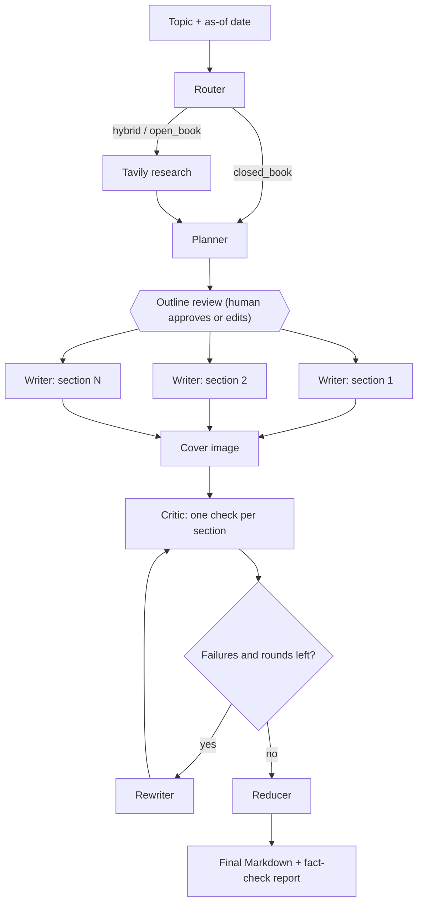

# AI Blog Writing Agent

A research-driven blog generation agent built with LangGraph, LangChain, OpenAI, Tavily and Streamlit. It decides whether a topic needs web research, plans the post, lets you review the outline, writes sections in parallel, fact-checks each section against the collected sources, rewrites the ones that fail, and assembles a Markdown document. The repo also includes an evaluation script that measures how well the fact-check loop works.

## Key Features

- **Adaptive research routing:** classifies each topic as `closed_book`, `hybrid` or `open_book` to decide whether web research is needed.
- **Web research:** Tavily search results are turned into structured evidence (title, URL, snippet, date).
- **Structured planning:** the outline is a Pydantic schema with goals, bullets, target word counts and per-section requirements for research, citations and code.
- **Human-in-the-loop outline review:** the graph pauses after planning. You can edit titles, goals, bullets and word targets, or remove sections, then approve. Uses LangGraph `interrupt` with a checkpointer.
- **Parallel section writing:** sections are generated concurrently with LangGraph's `Send`.
- **Fact-check and revise loop:** a critic checks every section against the evidence and flags unsupported claims, missing citations and skipped bullets. Cited URLs that are not in the evidence are rejected by code. Failed sections go to a rewriter, with at most 2 revision rounds.
- **Evaluation harness:** `eval_blogs.py` runs a topic set and reports pass rates, citation validity, word-count accuracy, an LLM-judge score and latency.
- **Optional cover image:** generated with the OpenAI image API (can be switched off).
- **Streamlit UI:** tabs for the plan, evidence, fact-check results, Markdown preview and logs, plus Markdown download.

## Architecture



### Components

1. **Router:** an LLM with structured output picks the research mode from the topic and as-of date.
2. **Research:** runs Tavily queries and normalises results into evidence items. In `open_book` mode, results with a known date older than the recency window are dropped. Results with no date are kept.
3. **Planner:** produces the title, audience, tone, blog kind, constraints and the task list.
4. **Outline review:** pauses the graph and waits for the approved or edited plan. Can be turned off for batch runs.
5. **Writers:** one worker per section, each receiving its task, the plan and the evidence (titles, URLs and snippets).
6. **Critic and rewriter:** each section is checked against the evidence. If there is no evidence outside `closed_book` mode, sections must not contain links or specific recent facts, since there is nothing to cite.
7. **Reducer:** orders sections by task ID, assembles the Markdown, builds the fact-check report, and saves `<blog-title>.md`.

## Evaluation

`eval_blogs.py` runs the full pipeline (no outline review) on 10 topics and records, per blog:

- fact-check pass rate on the first draft and after the revise loop
- invalid citation URLs (cited URLs that are not in the evidence) before and after
- citation validity of the final blog
- share of sections within ±25% of their target word count, and the average words/target ratio
- LLM-judge scores (relevance, depth, clarity, groundedness), with groundedness scored only when evidence exists
- latency

"Before" and "after" come from the same run: the first-draft verdicts versus the final verdicts.

### Run 1: before fixes

| Metric | Before critic | After critic loop |
|---|---|---|
| Sections passing fact-check | 73% | 84% |
| Invalid citation URLs per blog | 0.40 | 1.00 |

Broken down by mode, the `closed_book` and `hybrid` topics passed 100% on the first draft with no invalid URLs. The three `open_book` topics averaged 0.3 evidence items, a 47% final pass rate, and invalid URLs rising from 1.33 to 3.33 per blog.

**What went wrong:**

- The research step kept only results with a publication date inside the 7-day window, and Tavily often returns no date, so almost all sources were discarded.
- With no sources, the critic still demanded citations for sections marked as needing them, so the rewriter invented links. The loop made citations worse.

**Fixes:**

- Undated results are now kept.
- Writers and rewriters are told not to include links when no evidence exists.
- The critic no longer asks for citations it cannot get, and it fails sections that include links without evidence.

### Run 2: after fixes

| Metric | Before critic | After critic loop |
|---|---|---|
| Sections passing fact-check | 97% | 100% |
| Invalid citation URLs per blog | 0.20 | 0.00 |

| Mode | Runs | Avg evidence items | Pass (first draft) | Pass (after loop) | Invalid URLs first | Invalid URLs final |
|---|---|---|---|---|---|---|
| closed_book | 5 | 0.0 | 100% | 100% | 0.00 | 0.00 |
| hybrid | 2 | 14.0 | 86% | 100% | 1.00 | 0.00 |
| open_book | 3 | 14.3 | 100% | 100% | 0.00 | 0.00 |

| Other metric (final blogs) | Value |
|---|---|
| Citation validity | 100% |
| Sections within ±25% of target words | 66% |
| Average words / target words | 1.13 |
| Average revision rounds | 0.10 |
| Judge relevance / depth / clarity | 5.00 / 5.00 / 4.40 |
| Judge groundedness (runs with evidence) | 5.00 |
| Average latency | 43 s |

### Limitations of these results

- **The critic rarely fired.** The average was 0.10 revision rounds over 10 blogs, so these numbers show the loop works mechanically. They do not show that it substantially improves quality.
- **Small sample.** 10 topics, one run each. The router's mode choice also varies between runs.
- **Same-family judge.** The writer, critic and judge are all OpenAI models, and the judge scores sit at or near the maximum. Scores are optimistic and low in spread.
- **Citation checks are URL-based.** A cited URL being in the evidence does not prove the source supports the claim. The critic's claim check is an LLM judgement and has not been validated against planted errors.

## Tech Stack

| Component | Technology |
|---|---|
| Language | Python |
| Agent orchestration | LangGraph (with checkpointing and `interrupt`) |
| LLM integration | LangChain |
| Language model | OpenAI GPT-4.1 mini |
| Structured outputs | Pydantic |
| Web research | Tavily Search |
| Cover image | OpenAI image API (optional) |
| User interface | Streamlit |
| Data presentation | Pandas |
| Configuration | python-dotenv |

## Project Structure

```
project/
├── blog_backend.py        # LangGraph workflow, agents, critic loop
├── blog_frontend_mod.py   # Streamlit frontend
├── eval_blogs.py          # Evaluation harness
├── .env                   # API keys (do not commit)
├── .gitignore
└── README.md
```

Generated blogs are saved as `<blog-title>.md` in the working directory. Evaluation writes `eval_results.csv` and `eval_summary.md`.

## Getting Started

### 1. Clone and create a virtual environment

```bash
git clone <your-repository-url>
cd <your-repository-folder>
python -m venv .venv
```

Activate it on Windows with `.venv\Scripts\activate`, or on macOS/Linux with `source .venv/bin/activate`.

### 2. Install dependencies

```bash
pip install -U langgraph langchain-openai langchain-core langchain-community openai tavily-python streamlit pandas pydantic python-dotenv
```

### 3. Configure environment variables

Create a `.env` file:

```
OPENAI_API_KEY=your_openai_api_key
TAVILY_API_KEY=your_tavily_api_key
```

| Variable | Required | Purpose |
|---|---|---|
| `OPENAI_API_KEY` | Yes | All LLM calls and cover images |
| `TAVILY_API_KEY` | Recommended | Web research. Without it, no evidence is collected, so `hybrid` and `open_book` blogs are written without sources |
| `COVER_IMAGE` | No | Set to `0` to skip cover image generation (default `1`) |
| `JUDGE_MODEL` | No | Model used by the evaluation judge (default `gpt-4.1-mini`) |
| `SAVE_BLOGS` | No | Set to `0` to stop saving `.md` files (default `1`) |

Never commit your `.env` file.

### 4. Run the app

```bash
streamlit run blog_frontend_mod.py
```

1. Enter a topic and an as-of date in the sidebar.
2. Click **Generate Blog**.
3. Review and edit the outline, then click **Approve & write**. Untick "Review outline before writing" to skip this step.
4. Inspect the plan, evidence and **Fact-check** tab, read the Markdown preview, and download the blog.

### 5. Run the evaluation

```bash
python eval_blogs.py --n 3      # quick check on 3 topics
python eval_blogs.py            # all 10 default topics
```

Options: `--topics-file topics.txt` (one topic per line), `--max-revisions 2`, `--out eval_results.csv`. A full run takes roughly 10 to 15 minutes and makes real API calls.

## Deployment Notes

- Paused outline reviews are stored in an in-memory checkpointer, so they are lost when the server restarts. Use a persistent checkpointer (SQLite or Postgres) if that matters.
- Hosts such as Render have an ephemeral filesystem, so saved `.md` files disappear on restart. The Past Blogs list reads every `.md` in the working directory, which is shared between all visitors of a deployed instance.
- Every blog makes many paid API calls. Add authentication or spending limits before sharing a public link.

## Future Work

- Test the critic with planted errors (insert false or unsupported claims and measure the catch rate).
- Larger and repeated evaluation runs, and a judge model from a different family.
- Check whether each cited source actually supports its claim, not just that the URL exists.
- Persistent storage for blogs and checkpoints, with per-user history.
- Tracing and cost tracking (token usage per run).
- Automated tests for routing, research and graph behaviour.

## License

Add a license before distributing or accepting contributions.

---

*Project status: under active development.*